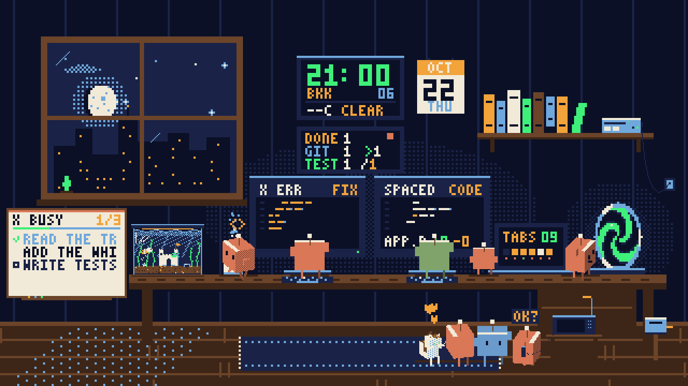
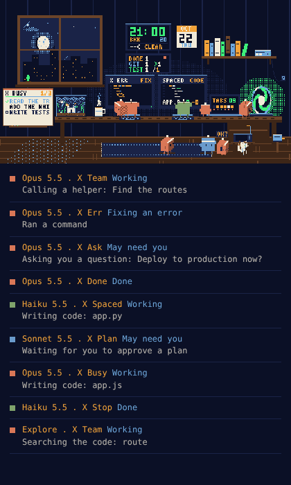

# Claude Office

A pixel room where every active [Claude Code](https://claude.com/claude-code) session is a little
3D Claude agent. Agents come in through a portal when a session starts and leave through it when the
session ends. The portal only appears when someone is coming or going, and the office cat opens it. They take one of the two computers to write code or run commands, read at the
bookshelf, browse on the laptop, wait with "!" when they need you, and spend their free time with
the office cat, the fish tank, a cup of tea and the view.

It only reads the transcripts Claude Code already saves in `~/.claude/projects`. It never calls
Claude, so **it costs no tokens and does not touch your usage limits.**

Works on **Windows, macOS and Linux**. It needs only Python 3.8+, with no packages to install.



## Features

- **One agent per session, in its model's colour:** Opus orange, Sonnet blue, Haiku green, Fable
  purple, other models grey. Helpers (subagents) are smaller Claudes in their session's colour, and
  their session goes to the portal to call them in.
- **Two computers** show what the agent at them is doing: `CODE` (Edit, Write) with code being
  typed, `RUN` (Bash) with a terminal and a progress bar, `FIX` after an error, and `DONE` when the
  task is finished. The title bar shows the project. When both are taken, the next agent waits by
  the tank with `<>` or `$` until one is free.
- **The intercom:** when a session needs your approval or asks you a question, its Claude goes to
  the intercom by the window, sits down with the handset and asks "OK?". The beacon flashes and the
  screen shows `ASK`; others who need you queue beside it. Tap the intercom to see what it is
  asking. A soft chime and a desktop notification can be turned on in the settings. Questions (`AskUserQuestion`) and plans to approve (`ExitPlanMode`)
  count straight away. With the hooks installed (below), permission prompts count the moment they
  appear; without them, a step that has waited 45 seconds counts.
- **The rest of the room:** reading files sends an agent to the bookshelf, web tools to the
  laptop and thinking shows `...`. Idle sessions sleep on the edge of the desk.
- **The laptop** counts the open tabs (sessions), with a dot for what each one is doing.
- **The portal** is closed until it is needed. When a Claude is about to arrive, leave or send a
  pushed commit, the cat runs over, jumps on the desk and paws the portal open, waits beside it
  until everyone is through, then hops down. Tap the empty spot on the wall to ask the cat to open it.
- **The cat** is an orange tabby by default (tuxedo and calico in the settings), with stripes, a
  collar and bell, blinking eyes and twitching ears. It naps, grooms and purrs when petted. It also
  hangs out with the Claudes: it sits on the keyboard of an idle computer (and hops off with a "!" when
  a Claude needs it), curls up next to a sleeping Claude, follows a Claude around the floor, and paws
  at the fish tank glass.
- **The plant** by the window grows with your work: each finished turn (Done) and passing test run
  counts 1 point, each commit 2 and each push 3. Its size comes from the last 30 days, it flowers on a
  big day (20 points or more), droops after 3 days without work and wilts after a week. Claudes water
  it in their free time. Tap it to see today's points. The counts are kept in
  `~/.claude/office-plant.json`.
- **Tests, commits and pushes:** a computer's light turns green when its session's tests pass and
  blinks amber when they fail, and the Claude cheers or winces. A push sends the Claude to the
  portal with a parcel ("SENT"). The CODE screen shows the file and the lines changed (+12 -3).
- **Today**, under the clock: turns finished, commits and pushes, tests passed and failed, and a dot
  in the colour of the busiest model. The wall calendar shows the date.
- **Little signs:** a Claude naps for a moment after the conversation is compacted, and stomps on a
  bug after three errors in a row. Background commands light up the Raspberry Pi. Mail tools send a Claude to the mailbox, calendar tools to
  the calendar, and teammates on the same project chat in their free time.
- **Free time** after a task: feed or tap the fish tank, pet the cat, sip tea, read a book,
  watch the sky (more often when it rains), stretch, dance or high-five another free agent.
- **A live window:** the clock, sun, moon (in its real phase), stars and city lights follow the
  room's time zone (Bangkok unless you change it), and the sky follows the live weather of the
  room's city: rain, storms with lightning, fog and clouds.
- **Settings:** tap the Raspberry Pi on the shelf (the one with the little gear) to change the time
  zone, weather city, the view out of the window and more. See Settings below.
- Hover or tap a Claude for its card: model, project, state, current step, turn time and context
  tokens used. In a tall side panel the sessions are also listed under the room.
- Tap things: the cat purrs, the tank gets fed, the cup steams, the window gets a shooting star, the
  clock switches between 24 and 12 hours, the plant shows its points.



## Let Claude set it up

Paste this into Claude Code (the terminal, the desktop app or an IDE) and it does the install for you:

```text
Please install Claude Office for me from https://github.com/devtint/CLAUDE-OFFICE

1. Check that Python 3.8 or newer and git are installed. If one is missing, tell me how to
   install it for my operating system and stop.
2. Clone the repository into my Claude Code skills folder:
   ~/.claude/skills/claude-office (on Windows: %USERPROFILE%\.claude\skills\claude-office).
   If that folder already exists, run "git pull" in it instead.
3. Read README.md and install.py before running anything, and tell me in one or two lines
   what they do.
4. Run install.py with Python from that folder to make the "Claude Office" and
   "Claude Office Off" desktop shortcuts.
5. Start the office with "open-office.pyw --server" and check that
   http://127.0.0.1:7788/state answers. If you are in the Claude desktop app, open
   http://127.0.0.1:7788 in the built-in browser panel.
6. Tell me how to open and stop it, and that from now on I can just say "start the office"
   or "stop the office".
```

Claude may ask for your OK before running commands. The office only reads your local session
files and never sends them anywhere.

## Update from an older version

Already using Claude Office? Paste this into Claude Code to update it:

```text
Please update my Claude Office skill to the newest version from
https://github.com/devtint/CLAUDE-OFFICE

1. Find where I installed it. It is usually ~/.claude/skills/claude-office
   (on Windows: %USERPROFILE%\.claude\skills\claude-office). If it is not there, look for a
   folder containing claude-office.py and ask me if you are not sure it is the right one.
2. In that folder run "git status". If there are local changes, show them to me and ask before
   doing anything that would discard them. Otherwise run "git pull".
   If the folder is not a git clone, tell me and offer to replace it with a fresh clone.
3. Tell me in a few lines what changed, from "git log --oneline -5" and README.md.
4. Read install.py and office-hook.py, then ask me whether to add the optional office hooks.
   They make the office show permission prompts and finished turns immediately, run only on
   those events and cost no tokens. If I say yes, run install.py with --hooks using Python
   (python3 on macOS and Linux, python on Windows). Tell me "install.py --uninstall-hooks"
   removes them.
5. If I use the desktop shortcuts, run install.py again (without --hooks) to refresh them.
6. Restart the office: run open-office.pyw with --stop, wait a moment, then run it again
   with --server.
7. Check that http://127.0.0.1:7788/state answers with JSON. If you are in the Claude desktop
   app, open http://127.0.0.1:7788 in the built-in browser panel.
8. Tell me it is updated, that "start the office" and "stop the office" work as before, that
   http://127.0.0.1:7788/?demo shows made-up sessions to try it, and that tapping the Raspberry Pi
   on the shelf opens the settings (time zone, weather city, units, the window view, the cat,
   what to show in the room, sound, alerts and more).
```

What changed since the open-plan office:

- It is now one room. The old `/rooms` and `/simple` pages are gone.
- The clock, sky and weather follow Bangkok by default; tap the Raspberry Pi on the shelf to pick
  another time zone and city. The page asks Open-Meteo for that city's weather every 10 minutes and
  sends nothing about you or your sessions; it can be turned off in the settings or with `?noweather`.
- Alert sounds moved from the intercom to the settings.
- The portal now opens only when needed, and the cat opens it. The whiteboard is gone.
- A plant by the window grows with your work, the cat plays with the Claudes, and there is optional
  ambient sound in the settings.
- New in the settings: the cat's coat (orange tabby, tuxedo or calico), seven views out of the
  window (city, mountain, ice mountain, shores, village, desert, forest, or a random one each day),
  each with its own wall and matching touches in the room, and a switch for each optional thing in
  the room (plant, tea cup, fish tank, cat, clock, calendar, Today board, mailbox, rug, decorations,
  moth).
- The Raspberry Pi blinks NEW when a newer version is on GitHub; tap it to copy the update prompt.
- Calm mode turns on by itself when your computer is set to reduce motion.
- A SCREEN section in the settings: brightness, pixel shift against OLED burn-in, keep the screen
  awake, and full screen (also on `F`, a double-click, and optionally the desktop shortcut). Keys
  `S`, `M`, `[` and `]` open the settings, switch the sound and change the brightness.
- Cards show the context tokens used, without a percentage, since transcripts do not record the window size.
- After adding the hooks, restart Claude Code (or start a new session) so it picks them up.

## Install

Or do it yourself. Clone it into your Claude Code skills folder, so Claude can open it for you too:

```bash
git clone https://github.com/devtint/CLAUDE-OFFICE ~/.claude/skills/claude-office
```

On Windows (PowerShell):

```powershell
git clone https://github.com/devtint/CLAUDE-OFFICE "$env:USERPROFILE\.claude\skills\claude-office"
```

Then make the two desktop shortcuts, and if you like, add the office hooks:

```bash
cd ~/.claude/skills/claude-office
python3 install.py           # on Windows: python install.py
python3 install.py --hooks   # optional: exact "needs you" and "done"
```

The hooks make Claude Code tell the office the moment a session shows a permission prompt or
finishes a turn. They are two tiny entries in `~/.claude/settings.json` (a backup is kept as
`settings.json.office-backup`) that run `office-hook.py` only on those events; it writes one small
file and costs no tokens. `install.py --uninstall-hooks` removes them and leaves your other
settings as they were.

| Shortcut | What it does |
|---|---|
| **Claude Office** | Starts the office if needed and opens it in a small app window |
| **Claude Office Off** | Stops it (the app window closes itself) |

On Windows they are `.lnk` files, on macOS `.app` bundles, and on Linux `.desktop` files. Run
`install.py` again if you move the folder, or `install.py --uninstall` to remove them.

The app window uses Edge, Chrome, Brave or Chromium, whichever it finds. Without one, the office
opens in your default browser.

**macOS:** the first time you open a shortcut, macOS may ask to confirm, because the app was made
on your Mac rather than downloaded. If it says Python is missing, run `xcode-select --install` or
install Python from python.org, then run `install.py` again.

## Use

- **Desktop:** double-click **Claude Office**.
- **Claude desktop app:** ask Claude to *"start the office"*. It opens in the built-in browser
  panel next to your chat. Say *"stop the office"* to close it.
- **Any browser:** start it with `python3 open-office.pyw --server`, then go to
  <http://127.0.0.1:7788>. Use `--stop` to stop it.

Add these to the address to try things out:

| Option | What it does |
|---|---|
| `/?demo` | Made-up sessions that come and go, to try it without Claude Code running |
| `?hour=21` | Shows the sky at another time of day (in the room's time zone) |
| `?weather=storm` | Shows a weather: `clear`, `cloudy`, `overcast`, `fog`, `rain`, `storm` or `snow` |
| `?noweather` | Turns off the weather request (see below) |

Keys, for a spare monitor or a small panel:

| Key | What it does |
|---|---|
| `F` or double-click the room | Full screen on or off (Esc also leaves). The Claude app's side panel may not allow full screen |
| `S` | Opens or closes the settings |
| `M` | Ambient sound on or off |
| `[` and `]` | Brightness down or up |

## Settings

Tap the **Raspberry Pi** on the shelf, the little box with a gear on it. Changes apply at once.

| Setting | What it does |
|---|---|
| Time zone | The clock, calendar and sky follow it. Bangkok by default, or "This computer" |
| Label | Up to 4 letters under the clock, like `BKK` or `TOK` |
| 24-hour clock | Off shows 12 hours with AM/PM (tapping the clock switches it too) |
| Live weather | Turns the weather request on or off |
| City | Type a city and press FIND, then pick it. Sets the weather, time zone and label |
| Units | Celsius or Fahrenheit |
| View | What the window looks out on: City, Mountain, Ice Mountain, Shores, Village, Desert or Forest, or Random each day. Each one also changes a few things in the room (see below) |
| Show in the room | A switch for each of: plant, tea cup, fish tank, cat, wall clock, calendar, Today board, mailbox, rug, view decorations and moth. Claudes skip what is hidden (no tea without the cup, no petting without the cat), and without the cat the portal opens by itself |
| Brightness | 30% to 100%. Darkens only the office page (a page cannot change the screen's own brightness); on an OLED darker pixels also wear less |
| Pixel shift | On by default. Every two minutes the whole room moves 2 screen pixels along a small loop, too little to notice, so the still edges (window, shelf, clock) do not wear the same pixels of an OLED all day |
| Keep the screen awake | Off by default. Stops the screen from sleeping while the office is showing, for a dedicated monitor. Works in Chrome, Edge and other browsers that support it |
| Desktop shortcut opens in full screen | The **Claude Office** shortcut opens the office full screen. That window uses its own small browser profile in `~/.claude/office-browser`, because a browser that is already open ignores the full screen request otherwise |
| Full screen | A button for the same thing as the `F` key |
| Alerts | A soft chime and a desktop notification when a Claude needs you |
| Leave after idle | How long a quiet session stays in the room: 5, 10, 30 or 60 minutes |
| Claudes at once | 2, 4, 6 or 8 |
| Cat | Orange tabby, Tuxedo or Calico |
| Show subagents | Helpers as small Claudes, or hidden |
| Check for updates | Once a day the office asks GitHub whether a newer version exists, sending only the commit id it is on. When there is one, the Raspberry Pi blinks NEW and the settings show what changed with a button to copy the update prompt. Turn it off here |
| Ambient sound | Off by default. Rain when it rains in your city (and thunder in storms), soft key clicks while a Claude types, purring when the cat is petted, a meow when it opens the portal. Browsers only play sound after you tap the page once, and it pauses while the page is hidden |
| Calm mode | No meteors or moth, lighter rain, half the frame rate, for slower computers. Turns on by itself when your computer is set to reduce motion |

Each view has its own day and night, and the live weather still falls on it:

| View | Outside | In the room |
|---|---|---|
| City | Skyline, office lights going off late at night | Navy wall panels, a cactus on the sill |
| Mountain | Snowy peaks, pines, a cabin with smoke and a lit window | A log cabin wall, skis and poles, a hanging lantern that glows at night, a pine sapling |
| Ice Mountain | Icy peaks over a frozen lake, an aurora on clear nights | A wall of ice blocks, frost in the window corners, skates on a nail, a snow globe |
| Shores | Waves, a sailboat, a lighthouse beam at night, moonlight on the water | Beach house planks, a life ring, a fishing net with a starfish, a striped beach towel, a seashell |
| Village | Fields, a windmill, houses with chimney smoke and lights, a lamp post | Plaster between timber beams, a flower wreath, a woven rug, flowers on the sill |
| Desert | Dunes and cacti, far more stars at night | Adobe bricks, a sun hat, a patterned rug, two cacti |
| Forest | Layered pines, birds by day, fireflies at night | Dark wooden boards with moss, ivy trailing from the window and shelf, a fern |

Add `?view=shore` (or any view) to the address to preview one without saving it.

They are saved in `~/.claude/office-settings.json`, so the desktop window, the side panel and the
tracker all share them. RESET goes back to the defaults. The city search uses Open-Meteo's free
geocoding and runs only when you press FIND.

## How it works

- `tracker.py` reads the session transcripts once a second (only those changed in the last 36 hours)
  and works out each session's model, state, current tool, recent steps, task list, tests, commits and
  pushes. A session stays in the room while its transcript changed in the last 10 minutes (see
  Settings).
- `office-hook.py` is the optional Claude Code hook (see Install).
- `claude-office.py` is a small local server on `127.0.0.1:7788`. It serves the room, `/state`
  (the sessions as JSON, with today's numbers and the plant) and `/settings`. It only listens on your own computer, and only one runs at a time.
- `workspace.html` is the room: a 320x180 pixel canvas scaled up crisp, drawn in eight colours with
  a tiny 3D renderer for the agents and the cat. It polls `/state` every 1.5 seconds and turns each
  session's state and tool into what its agent does. All the animation, physics and free-time
  behaviour runs in the page.
- `open-office.pyw` is the launcher, and `install.py` makes the shortcuts.

The one request the page makes outside your computer is the weather for the room's city (Bangkok
by default) from [Open-Meteo](https://open-meteo.com) (no key, no account, nothing about you or
your sessions is sent), every 10 minutes, plus a city search when you press FIND in the settings.
Turn the weather off in the settings, or add `?noweather` to the address.
The server also asks GitHub once a day whether a newer version exists, sending only the commit id
this copy is on, and keeps the answer in `~/.claude/office-update.json`. Turn that off with "Check
for updates" in the settings.

If something goes wrong, the last error is kept in `office-error.log` next to the scripts.

## See also

[Claude Pet](https://github.com/devtint/claude-pet), an always-on-top desktop box with a pixel
Claude for each session.

## License

MIT
